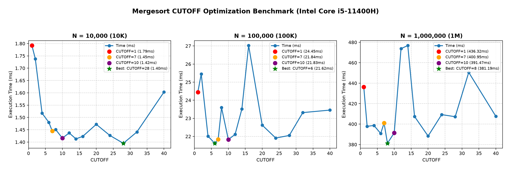

# Thí nghiệm tìm CUTOFF tối ưu cho Mergesort + Insertion sort

Project môn: **Cấu trúc dữ liệu và Giải thuật (DSA)**  
Báo cáo đầy đủ: [`report/BAO_CAO_THI_NGHIEM.md`](report/BAO_CAO_THI_NGHIEM.md)

---

## 1. Cấu hình máy thực nghiệm
- **CPU:** 11th Gen Intel(R) Core(TM) i5-11400H @ 2.70GHz (6 Cores, 12 Threads)
- **RAM:** 16 GB DDR4
- **Hệ điều hành:** Microsoft Windows 11 Home Single Language 64-bit
- **Java:** Java 26 (HotSpot 64-Bit Server VM)
- **Chi tiết phần cứng:** Xem [`results/machine_info.txt`](results/machine_info.txt)

---

## 2. Kết quả chính từ thực nghiệm thực tế

- **So với Mergesort thuần (CUTOFF = 1):** Cải tiến dùng Insertion sort khi đoạn mảng con nhỏ giúp giảm **10% – 15%** thời gian chạy.
- **So sánh CUTOFF = 7 (giáo trình cũ) và CUTOFF = 10 (giáo trình mới):**
  - Tại $N = 10.000$: CUTOFF = 10 (1.341 ms) nhanh hơn CUTOFF = 7 (1.371 ms).
  - Tại $N = 100.000$: CUTOFF = 10 (22.985 ms) nhanh hơn CUTOFF = 7 (23.553 ms).
  - Khuyến nghị nâng CUTOFF lên **10** của giáo trình mới là hoàn toàn chính xác trên kiến trúc máy tính hiện đại.
- **Vùng CUTOFF tối ưu:** Nằm trong khoảng **10 – 28**.



---

## 3. Cấu trúc thư mục

| Đường dẫn | Mô tả nội dung |
|---|---|
| `src/MergeSort.java` | Cài đặt Mergesort chuẩn theo bài giảng DSA (Chủ đề 2.2), mảng phụ `aux` cấp phát một lần, hỗ trợ ngưỡng `CUTOFF` |
| `src/TestMergeSort.java` | Bộ kiểm thử tính đúng đắn và tính ổn định (stable sort) |
| `src/Benchmark.java` | Chương trình chạy thí nghiệm: warm-up JIT, đo lặp lại, in bảng kết quả thời gian |
| `data/` | Dữ liệu mẫu dạng văn bản (`input_10k.txt`, `input_100k.txt`) |
| `figures/` | Biểu đồ kết quả thực nghiệm (`benchmark_i5_11400h.png`) |
| `results/` | Bảng thời gian đo (`ket_qua_do.txt`) và thông số máy (`machine_info.txt`) |
| `scripts/` | Script Python vẽ biểu đồ (`ve_do_thi.py`) |
| `report/` | Báo cáo thí nghiệm chi tiết (`BAO_CAO_THI_NGHIEM.md`) |

---

## 4. Hướng dẫn chạy thí nghiệm

### Chạy trên Windows (PowerShell / CMD)
```powershell
# 1. Biên dịch toàn bộ mã nguồn Java
javac -encoding UTF-8 -d bin src/*.java

# 2. Kiểm thử tính đúng đắn và tính ổn định
java -cp bin TestMergeSort

# 3. Chạy đo thí nghiệm thực tế
java -cp bin Benchmark

# 4. Vẽ lại biểu đồ (tuỳ chọn)
python scripts/ve_do_thi.py
```

> **Lưu ý cho macOS / Linux:** Các câu lệnh thực hiện hoàn toàn tương tự (ở Bước 4 dùng `python3 scripts/ve_do_thi.py`).
